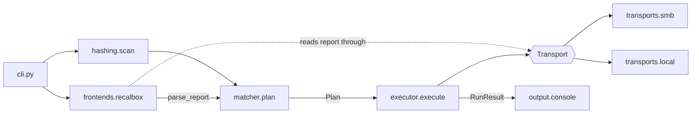

# Architecture

**Status:** this is how BECK works since [step 04.13](../roadmap/04-architecture-refactor.md). `check_bios.py` is only a
shim that runs `beck.cli.main`. [`tests/unit/test_architecture.py`](../tests/unit/test_architecture.py) checks the rules
below on the source. Why it's built this way: [ADR-0006](adr/0006-core-and-adapters.md).

BECK reads the report of missing BIOS files from a device, hashes the user's local files, matches the two by MD5, and
copies the matches to the right place on the device. A **core** makes the decisions, and **adapters** around it talk to
the outside world.

## Layout

```text
src/beck/
├── __init__.py          # __version__ from importlib.metadata
├── __main__.py          # python -m beck
├── cli.py               # argparse wiring and exit codes (minimal here, full in stage 06)
├── errors.py            # BeckError hierarchy, each with an exit code
├── models.py            # frozen dataclasses: MissingBios, LocalFile, PlannedUpload, Plan, RunResult
├── hashing.py           # chunked MD5, local folder scan
├── matcher.py           # pure: (missing entries, local files) -> Plan
├── executor.py          # applies a Plan through a Transport; dry-run aware
├── frontends/
│   ├── __init__.py      # registry: {"recalbox": RecalboxAdapter}
│   ├── base.py          # FrontendAdapter Protocol
│   └── recalbox.py      # report location, parser, device path -> relative path
├── transports/
│   ├── __init__.py
│   ├── base.py          # Transport Protocol (context manager)
│   ├── local.py         # folder on disk: mounted SD/USB, on-device runs, tests
│   └── smb.py           # pysmb (DEC-53)
└── output/
    ├── __init__.py
    └── console.py       # human output: colors, NO_COLOR, TTY detection
```

## Data flow



1. `cli.py` loads the settings, picks a frontend adapter and opens a transport.
2. The report is read through the transport, and the adapter parses its text into `MissingBios` entries.
3. `hashing.scan` turns the local folder into `LocalFile` items.
4. `matcher.plan` turns both lists into a `Plan`. Nothing has been written yet.
5. `executor.execute` applies the plan through the transport and returns a `RunResult`. With `dry_run=True`, it calls no
   write method.
6. `output/console.py` renders the result, and `cli.py` returns the exit code.

## Modules

| Module | Responsible for | Doesn't |
|---|---|---|
| `cli.py` | Connecting the parts; turning a `BeckError` into a message and an exit code | Contain matching or parsing logic |
| `errors.py` | `BeckError` and its subclasses, each with a fixed exit code | Print anything |
| `models.py` | Frozen, typed data passed between modules. Remote paths are relative to the BIOS root | Do I/O |
| `hashing.py` | Chunked MD5, and a recursive, sorted scan that skips hidden files | Use the network |
| `matcher.py` | Deciding which file fills which target (rules below) | Do any I/O |
| `executor.py` | Creating folders and uploading through a `Transport`; recording a failed item and continuing | Delete local files, or know which transport it's using |
| `frontends/` | One adapter per system: where its report is, how to parse it, and how device paths map to relative paths | Open connections |
| `transports/` | Reading, checking and writing files on a target | Know about reports or matching |
| `output/` | Rendering a `RunResult` for people | Decide anything |

## Matching rules
`matcher.plan` keeps the behavior proven in stage 03:

- One local file can fill many targets, each under the target's name.
- Each target is filled once, even if several report entries point at it.
- A target goes first to a local file with its exact name, if that file's MD5 is on the target's list. Other targets go
  to the first file by path.
- Identical local files upload once, and the others are listed as duplicates.
- A file that's `INCORRECT` on the device is kept (DEC-54): its target goes in `Plan.incorrect`, and a local file that fits it stays
  unmatched. `--overwrite` makes these targets normal ones (DEC-61).
- A file already on the target is kept, and `--overwrite` replaces it (DEC-61). The executor checks this, because the matcher does no I/O.
- The plan doesn't depend on input order.

## Rules

These are the boundaries to keep when changing the code:

1. **The core never does network I/O.** `models`, `hashing` and `matcher` don't import a transport. Only `hashing` reads
   the local disk, and `matcher` does no I/O at all.
2. **`sys.exit` only in `cli.py`.** Everything else raises a `BeckError`, or returns.
3. **Only adapters know about devices.** Recalbox paths and report formats stay in `frontends/`, and SMB stays in
   `transports/`. Only `transports/smb.py` imports `pysmb`.
4. **`executor` depends on the `Transport` Protocol**, never on a specific transport.
5. **Never delete or rename a user's local file** without an explicit opt-in flag (DEC-02). Those flags arrive in stage
   06.
6. **Secrets don't leave the transport.** `Transport.describe()` is for messages and never includes a password.
7. **Output goes to its own stream.** Human output goes to stdout, and logs from `logging.getLogger("beck")` go to stderr.

## Errors

| Error | Exit code |
|---|---|
| `UsageError`, `ConfigError` | 2 |
| `TransportError` | 3 |
| `ReportNotFoundError`, `ReportParseError` | 4 |
| Anything else (unexpected) | 1 |

## Extending BECK

- **A new frontend** (stage 11): add an adapter in `frontends/` that follows `FrontendAdapter`, register it, and add real
  report fixtures for it.
- **A new transport**: add a class in `transports/` that follows `Transport`. Only `cli.py` needs to know it exists.

The Protocols exist because DEC-03 and DEC-04 need them. Don't add a plugin system or other abstractions beyond them.
