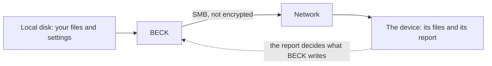

# Threat model

What BECK protects, what it trusts, how it defends itself, and what it doesn't try to do. To report a problem, see [the security policy](../SECURITY.md).

## What's worth protecting

- **Your BIOS files:** they're yours, and BECK must not lose them. Deleting one takes a flag you chose (DEC-02).
- **Your SMB credentials:** the password, and less so the user name.
- **The BIOS folder on your device:** BECK must not write outside it, or replace something by surprise.

## What BECK trusts

BECK trusts your account and your computer. It doesn't trust **what it reads**: a report or a settings file could be corrupted or crafted, a file name can hold
anything, and whatever answers on the network might not be your Recalbox.

## Threats, and what stops them

| Threat | What stops it | Tested in |
|---|---|---|
| **A password leaks** into a log, an error or a document. | The file can't hold one, and neither can a URL. It comes from `BECK_SMB_PASSWORD` or a prompt, stays in memory, and BECK never prints it. As a second defense, what repeats it by accident is masked, and a URL always loses its credentials. | `tests/unit/test_redaction.py`, with the mask and without it |
| **A password shows** while it's typed. | BECK refuses to ask if it can't hide what you type. | `tests/unit/test_credentials.py` |
| **A password is committed.** | Git ignores the old settings file, the new one lives outside the repository, and CI runs gitleaks and a check on what's tracked. | `tests/test_repo_hygiene.py` |
| **A destructive mistake** deletes your files. | Nothing is deleted without `--move` or `--clean-unmatched`, it asks first, and without a terminal it needs `--yes`. `--clean-unmatched` stops if anything failed or an entry was refused. | `tests/unit/test_safety_flags.py` |
| **A replaced file** on the device. | BECK keeps what's there unless you pass `--overwrite` (DEC-61). | `tests/unit/test_safety_flags.py` |
| **A crafted report** writes outside the BIOS folder, or into another folder. | An entry whose path could leave it, or holding a backslash or control characters, is refused. `SmbTransport` and `LocalTransport` refuse such paths too. | `tests/unit/test_path_safety.py`, and on a real server |
| **A crafted name** acts on your terminal, or fakes the list you confirm before deleting. | Human output and logs show it escaped. | `tests/unit/test_console.py` |
| **A damaged upload** counts as done, and then the local file goes. | Every upload has its size checked, and `--verify` compares its MD5 too. If it doesn't match, it's `failed`, and the local file stays. | `tests/unit/test_upload_integrity.py` |
| **An output that fails** changes what a run does. | Output can't change the run or its exit code (DEC-62). | `tests/unit/test_output_streams.py` |
| **The supply chain:** a bad dependency or tool. | A 14-day cooldown on new versions (DEC-45), a lockfile, GitHub Actions pinned by commit, downloaded tools checked by SHA-256, and a Trivy scan on every PR and every week. Signed attestations and an SBOM are planned for the first release (stage 10), and don't exist yet. | `tests/test_workflow_pins.py` |

## Risks it accepts

- **SMB isn't encrypted here.** `pysmb` has no SMB encryption (DEC-53). The password isn't sent as plain text, because the login uses NTLMv2, but your files and the report are, and someone on your network can read or
  change them. `--verify` catches damage, but it can't stop someone who can change what it reads back. Use BECK on a network you trust.
- **BECK can't tell it's talking to your Recalbox.** SMB here doesn't check who the server is. A fake one that you connect to gets your files, and with a user name, a login exchange that could be attacked offline, so a strong password matters.
- **MD5 identifies files. It doesn't protect them.** It's what Recalbox's report uses. Two different files can be crafted to have the same MD5, so a match means "the file the report asks for", not that the file is trustworthy.
- **`BECK_SMB_PASSWORD` is only as safe as your account.** Other programs running as you can read it, and setting it on the command line leaves it in your shell's history. The prompt avoids both.
- **A malicious server can use up your memory.** BECK reads the report, and with `--verify` each upload, into memory, with no size limit. Any Trivy finding accepted for a while, such as the `pyasn1` bugs that let a server hang BECK until November 2026, is listed in `.trivyignore`, with its expiry date.
- **A damaged upload stays on the device,** because BECK has no way to delete there. It's reported, and `--overwrite` tries again.
- **A symlink in your BIOS folder is followed,** if it points to a file. BECK treats that file as yours, and uploads it if the report asks for it.
- **What the device does is up to the device.** Its Samba settings, including its default guest access, and any links on its share aren't BECK's to control.
