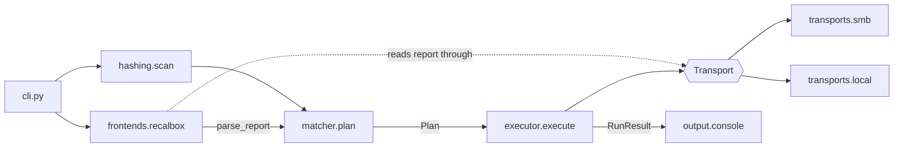

# Stage 04 — Architecture refactor

**Status:** Not started · **Depends on:** 03 · **Branch:** `stage/04-architecture` · **Effort:** L

## Goal
Turn the single script into a small, typed, testable package, `beck`. It has a **pure core** (parse → match →
plan) and swappable **adapters** around it: frontends (Recalbox first, DEC-03), transports (SMB and local
folder, DEC-04) and output. User-visible behavior stays the same as at the end of stage 03.

## Why
- Architecture 2/10, maintainability and portability are low ([assessment](00-assessment.md#scorecard)).
- Later stages need clean seams: `--json` output (06), config precedence (07), more frontends (11).
- DEC-26 switches the SMB library to `smbprotocol`. Doing that behind a `Transport` interface keeps the
  change contained.

## Decisions applied
DEC-01, DEC-02, DEC-03, DEC-04, DEC-08, DEC-17, DEC-18, DEC-26, DEC-43.

## Target layout

```text
src/beck/
├── __init__.py          # __version__ from importlib.metadata
├── __main__.py          # python -m beck
├── cli.py               # argparse wiring and exit codes (minimal here, full in stage 06)
├── errors.py            # BeckError hierarchy, each with an exit code
├── models.py            # frozen dataclasses: MissingBios, LocalFile, PlannedUpload, Plan, RunResult
├── hashing.py           # chunked MD5, local folder scan
├── matcher.py           # pure: (missing entries, local files) -> Plan
├── executor.py          # applies a Plan through a Transport; dry-run aware
├── frontends/
│   ├── __init__.py      # registry: {"recalbox": RecalboxAdapter}
│   ├── base.py          # FrontendAdapter Protocol
│   └── recalbox.py      # report location, parser, device path -> relative path
├── transports/
│   ├── __init__.py
│   ├── base.py          # Transport Protocol (context manager)
│   ├── local.py         # folder on disk: mounted SD/USB, on-device runs, tests
│   └── smb.py           # smbprotocol (smbclient API)
└── output/
    ├── __init__.py
    └── console.py       # human output: colors, NO_COLOR, TTY detection
```



## Steps

### 04.1 — Spike: smbprotocol against a real Recalbox (gate for DEC-26)
- [ ] Done
- **What:** Before rewriting the transport, prove that `smbprotocol`'s `smbclient` API works against the owner's
  Recalbox. The agent writes `docs/spikes/smbprotocol.md` containing a short script (not committed as code).
  The **owner runs it** and records the results:
  - **guest** login (empty user) and **password** login;
  - `smbclient.listdir` on the BIOS share; reading `missing_bios_report.txt`;
  - `smbclient.makedirs` and writing **one test file** into a new folder `beck-spike/`, then deleting only that
    test file and folder;
  - the negotiated dialect, and whether encryption can be enabled.

  If guest login or any basic operation fails, **stop**. Report to the owner with the options (keep pysmb
  behind the same interface, or another library) and record a new DEC that supersedes DEC-26 before continuing.
- **Files:** `docs/spikes/smbprotocol.md`
- **Done when:** The results table is filled in and the owner confirms DEC-26 stands.
- **Verify:** Owner sign-off in the document.
- **Commit message:** `docs(spike): verify smbprotocol against a real Recalbox share`

### 04.2 — Architecture document and ADR
- [ ] Done
- **What:** `docs/ARCHITECTURE.md` with the layout and diagram above, the responsibility of each module, the
  data flow, and the rules: the core (`models`, `hashing`, `matcher`) never does network I/O; `exit` only in
  `cli.py`; adapters are the only code that knows about Recalbox paths or SMB. Add
  `docs/adr/0006-core-and-adapters.md`.
- **Files:** `docs/ARCHITECTURE.md`, `docs/adr/0006-core-and-adapters.md`, `AGENTS.md` (link)
- **Done when:** The document matches this stage's target layout.
- **Verify:** `uv run pytest tests/test_docs_links.py -q`
- **Commit message:** `docs(architecture): describe core and adapter design`

### 04.3 — Package skeleton (src layout, uv_build, entry points)
- [ ] Done
- **What:**
  ```toml
  [build-system]
  requires = ["uv_build>=<current>,<<next minor>"]   # pin the range uv recommends at the time
  build-backend = "uv_build"

  [tool.uv.build-backend]
  module-name = "beck"            # distribution is beck-bios, import name is beck

  [project.scripts]
  beck = "beck.cli:main"
  ```
  - Remove `[tool.uv] package = false`.
  - Create `src/beck/__init__.py` (`__version__ = importlib.metadata.version("beck-bios")`), `__main__.py`, and a
    `cli.py` whose `main()` for now calls into the legacy code, so behavior is unchanged.
  - The root `check_bios.py` stays **as is** until 04.13.
  - Coverage `source = ["beck", "check_bios"]`.
- **Files:** `pyproject.toml`, `uv.lock`, `src/beck/__init__.py`, `src/beck/__main__.py`, `src/beck/cli.py`
- **Done when:** `uv run beck --help` and `uv run python -m beck --help` work, and `uv build` produces a wheel.
- **Verify:** `uv sync && uv run beck --help && uv build && unzip -l dist/*.whl | grep beck/__init__.py`
- **Commit message:** `build: package BECK as beck-bios with a beck console command`

### 04.4 — Error hierarchy and exit codes
- [ ] Done
- **What:** `errors.py`: `BeckError(Exception)` with `exit_code: int`. Subclasses: `UsageError`/`ConfigError`
  (2), `TransportError` (3), `ReportNotFoundError`/`ReportParseError` (4). Anything else is unexpected (1). This
  matches the exit-code table that stage 06 publishes (DEC-23). Library code raises; only `cli.main` turns
  errors into messages and exit codes.
- **Files:** `src/beck/errors.py`, `tests/unit/test_errors.py`
- **Done when:** Each class has a fixed, tested exit code.
- **Verify:** `uv run pytest tests/unit/test_errors.py -q`
- **Commit message:** `feat(core): add error hierarchy with stable exit codes`

### 04.5 — Domain models
- [ ] Done
- **What:** Frozen, slotted dataclasses in `models.py`:
  - `MissingBios(name, target: PurePosixPath, md5s: frozenset[str], required: bool | None, system: str | None)`
    — `required` comes from the report's `MISSING R…` / `MISSING O…` marker when present.
  - `LocalFile(path: Path, relative: PurePosixPath, md5: str, size: int)`
  - `PlannedUpload(source: LocalFile, target: PurePosixPath, entry: MissingBios)`
  - `Plan(uploads, directories, duplicates, unmatched, still_missing)` — tuples, sorted deterministically.
  - `RunResult(plan, completed, skipped, errors, dry_run)`

  All remote paths are `PurePosixPath` **relative to the target's BIOS root**.
- **Files:** `src/beck/models.py`, `tests/unit/test_models.py`
- **Done when:** The models are typed under `mypy --strict` and their invariants are tested (lowercase MD5s,
  relative targets only).
- **Verify:** `uv run mypy && uv run pytest tests/unit/test_models.py -q`
- **Commit message:** `feat(core): add typed domain models`

### 04.6 — Hashing and local scanning module
- [ ] Done
- **What:** Move the stage 03 scanner and hashing into `hashing.py`: `md5_file(path) -> str` and
  `scan(folder) -> list[LocalFile]` (recursive, hidden files skipped, deterministic order). Port the stage 03
  tests unchanged in intent.
- **Files:** `src/beck/hashing.py`, `tests/unit/test_hashing.py`
- **Done when:** All ported tests pass against the new module.
- **Verify:** `uv run pytest tests/unit/test_hashing.py -q`
- **Commit message:** `refactor(core): move hashing and scanning into beck.hashing`

### 04.7 — Frontend adapter interface and Recalbox adapter
- [ ] Done
- **What:**
  - `frontends/base.py`: a `FrontendAdapter` Protocol with `name: str`, `report_path: PurePosixPath`,
    `parse_report(text: str) -> list[MissingBios]`.
  - `frontends/recalbox.py`: the stage 03 parser plus the `/recalbox/share/bios/` → relative-path mapping.
  - `frontends/__init__.py`: `get_adapter(name) -> FrontendAdapter` from a registry dict. An unknown name raises
    `UsageError` listing the known adapters.
  - The fixture tests from 03.5 run against `RecalboxAdapter.parse_report`.
- **Files:** `src/beck/frontends/*.py`, `tests/unit/test_recalbox_adapter.py`
- **Done when:** Every real and derived fixture parses to its `.expected.json`.
- **Verify:** `uv run pytest tests/unit/test_recalbox_adapter.py -q`
- **Commit message:** `feat(frontends): add adapter interface and Recalbox adapter`

### 04.8 — Transport interface and local transport
- [ ] Done
- **What:**
  - `transports/base.py`: a `Transport` Protocol, used as a context manager, with `read_bytes(path)`,
    `exists(path)`, `size(path)`, `makedirs(path)`, `upload(local, remote) -> int` (bytes written), and
    `describe() -> str` (for messages; never includes secrets).
  - `transports/local.py`: `LocalTransport(root: Path)` built on `pathlib` and `shutil.copyfile`. It refuses
    any path that resolves outside `root`. Used for a mounted SD card or USB drive, for runs on the device
    itself, and as the test double.
- **Files:** `src/beck/transports/base.py`, `src/beck/transports/local.py`, `tests/unit/test_local_transport.py`
- **Done when:** Tests cover nested `makedirs`, upload, size, reading, and rejection of `../` escapes.
- **Verify:** `uv run pytest tests/unit/test_local_transport.py -q`
- **Commit message:** `feat(transports): add transport interface and local folder transport`

### 04.9 — SMB transport on smbprotocol (D4, D11, D16)
- [ ] Done
- **What:** `transports/smb.py`: `SmbTransport(host, port, share, user, password, timeout)` using
  `smbclient.register_session(...)` once in `__enter__`, and UNC paths `\\host\share\<relative>`. It uses
  `smbclient.makedirs(..., exist_ok=True)`, which is natively recursive (final D4), `smbclient.open_file`
  with `shutil.copyfileobj` for uploads, and `smbclient.stat` for sizes. It cleans up the session in
  `__exit__` (final D11). Direct TCP on 445 is the library's default (final D16). Library exceptions map to
  `TransportError` with readable messages (auth failure, share not found, host unreachable, timeout).
  Guest/empty credentials behave as verified in the 04.1 spike. Replace `pysmb` with `smbprotocol` in the
  dependencies (`uv remove pysmb && uv add smbprotocol`).
- **Files:** `src/beck/transports/smb.py`, `pyproject.toml`, `uv.lock`, `tests/unit/test_smb_transport.py`
- **Done when:** Unit tests with a mocked `smbclient` module cover the call sequence and the error mapping.
  Real-server tests come in stage 05.
- **Verify:** `uv run pytest tests/unit/test_smb_transport.py -q`
- **Commit message:** `feat(transports)!: implement SMB transport on smbprotocol`

### 04.10 — Pure matcher
- [ ] Done
- **What:** `matcher.plan(missing: Sequence[MissingBios], local: Sequence[LocalFile]) -> Plan`, a pure
  function with no I/O. It carries over the 03.8 behavior: one file can satisfy many entries; duplicate local
  files are listed; each entry counts once. It also lists the remote `directories` that uploads need, and the
  entries that are `still_missing`.
- **Files:** `src/beck/matcher.py`, `tests/unit/test_matcher.py`
- **Done when:** The ported 03.8 tests pass, plus: the plan is deterministic regardless of input order; the
  plan never references a local path outside the scanned folder.
- **Verify:** `uv run pytest tests/unit/test_matcher.py -q`
- **Commit message:** `refactor(core): extract a pure matcher that builds an upload plan`

### 04.11 — Executor with dry-run support
- [ ] Done
- **What:** `executor.execute(plan, transport, *, dry_run: bool) -> RunResult`:
  - It creates the directories, then uploads. A failure on one item is recorded in `errors` and the run
    **continues** with the other items (previously any error stopped the run).
  - With `dry_run=True` it calls **no** write method on the transport.
  - It **never deletes anything** (DEC-02). The opt-in `--move` / `--clean-unmatched` come in stage 06.
  - For **remote files that already exist**, keep stage 03 behavior (overwrite, as SMB uploads did). Stage 06
    asks the owner for the final policy.
- **Files:** `src/beck/executor.py`, `tests/unit/test_executor.py`
- **Done when:** Tests with `LocalTransport` on `tmp_path` cover a normal run, a dry run with zero changes on
  disk, a partial failure that continues, and the source folder unchanged afterwards.
- **Verify:** `uv run pytest tests/unit/test_executor.py -q`
- **Commit message:** `feat(core): add plan executor with dry-run and per-item error handling`

### 04.12 — Console output and logging
- [ ] Done
- **What:**
  - `output/console.py`: a `ConsoleRenderer` that renders a `RunResult` like today's output (colors, per-file
    lines, final summary). Color rules: `NO_COLOR` set → no color; `FORCE_COLOR` set → color; otherwise color
    only when the stream is a TTY. On Windows, enable ANSI processing with the standard library (`ctypes`
    `SetConsoleMode`), falling back to no color. No new dependency.
  - Use `logging.getLogger("beck")` for diagnostics. Logs go to **stderr**; the human output goes to stdout.
- **Files:** `src/beck/output/*.py`, `tests/unit/test_console.py`
- **Done when:** Tests cover all color cases and that the rendered text contains the expected summary lines.
- **Verify:** `uv run pytest tests/unit/test_console.py -q`
- **Commit message:** `feat(output): add console renderer with NO_COLOR support and logging`

### 04.13 — Thin CLI with behavior parity
- [ ] Done
- **What:**
  - `cli.main(argv: list[str] | None = None, *, base_dir: Path | None = None) -> int` wires it all together:
    load the legacy config, open the transport, read and parse the report, scan, plan, execute, render. It maps
    `BeckError` to its exit code and anything else to 1.
  - With no arguments, `beck` uses `./config/config.yml` and `./bios` relative to the **current directory**
    (an installed tool has no meaningful script folder).
  - The root `check_bios.py` becomes a 5-line shim. It prints a deprecation notice ("use `beck`") and calls
    `main(base_dir=<its own folder>)`, so old usage keeps working.
  - Port every stage 03 test to drive `cli.main` with `LocalTransport`, or a patched SMB transport where needed.
- **Files:** `src/beck/cli.py`, `check_bios.py`, `tests/**`
- **Done when:** All stage 03 regression tests pass through the new code path.
- **Verify:** `uv run pytest -q`
- **Commit message:** `refactor(cli): route all behavior through the beck package`

### 04.14 — Remove legacy code and pysmb; strict typing everywhere
- [ ] Done
- **What:** Delete the legacy functions (only the shim stays in `check_bios.py`). Remove the mypy relaxed
  override and the `pythonpath = ["."]` pytest setting. Point mypy `files` at `src` and `tests`. Regenerate
  `requirements.txt`. Coverage `source = ["beck"]`.
- **Files:** `check_bios.py`, `pyproject.toml`, `uv.lock`, `requirements.txt`
- **Done when:** `mypy --strict` passes on all of `src/` with no overrides except third-party stubs, and pysmb is
  gone from the lockfile.
- **Verify:** `uv run mypy && uv run pytest --cov && ! grep -qi pysmb uv.lock`
- **Commit message:** `refactor!: remove legacy script internals and pysmb`

### 04.15 — Close the stage
- [ ] Done
- **What:** Update AGENTS.md (repo map, architecture link, "the core is pure; adapters do I/O"). Re-score
  [00-assessment](00-assessment.md#re-scoring-history) and mark D3, D4, D11 and D16 fully fixed. Update the
  [README](README.md#stages) status. Print the push and PR commands for the human:

  ```sh
  git push -u origin stage/04-architecture
  gh pr create --base main --title "Stage 04: architecture refactor" --body "Closes roadmap stage 04."
  ```

- **Files:** `AGENTS.md`, `roadmap/00-assessment.md`, `roadmap/README.md`, this file
- **Done when:** The PR is merged with a merge commit.
- **Verify:** `uv run beck --help` works and the full check suite from AGENTS.md passes.
- **Commit message:** `docs(roadmap): close stage 04 and re-score assessment`

## Stage acceptance criteria
- `uv run beck` behaves like the end of stage 03, and `python check_bios.py` still works through the shim.
- No module except `cli.py` calls `sys.exit`; no core module imports a transport.
- `mypy --strict` passes on `src/`; pysmb is gone; smbprotocol has been verified on a real device.

## Out of scope
- New flags, `--json`, config precedence and TOML (stages 06–07); new frontends (stage 11).

## Agent notes
- Move code in small steps and keep the tests green after **every** step. If a step would break parity, stop and
  record why.
- Don't add abstraction beyond what this file describes. The Protocols exist because DEC-03 and DEC-04 need
  them; nothing else needs a plugin system yet.
