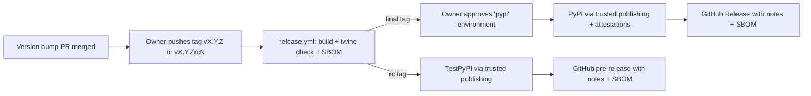

# Stage 10 — Packaging & release

**Status:** Not started · **Depends on:** 09 · **Branch:** `stage/10-release` · **Effort:** M

## Goal
Publish BECK as `beck-bios` on PyPI through **trusted publishing**, with attestations, an SBOM, generated
release notes, and a rehearsal on TestPyPI. Users can then run `pipx install beck-bios` or
`uv tool install beck-bios` and get a `beck` command. Define what 1.0 means and get there.

## Why
- Packaging & distribution scored 1/10; git hygiene/versioning 5/10 (no tags, releases or changelog).
- An installable CLI is the vision (DEC-01). Signed provenance and an SBOM let users and distributors check
  what they install (DEC-37).

## Decisions applied
DEC-11, DEC-13, DEC-15, DEC-18, DEC-20, DEC-34, DEC-37, DEC-41, DEC-43.

## Release flow (reference)



## Steps

### 10.1 — Check the PyPI name and set up trusted publishing (human-only)
- [ ] Done
- **What:** The owner:
  1. Checks that `beck-bios` is free on PyPI and TestPyPI. If it's taken, **stop**: choose another name with the
     agent and record a DEC superseding DEC-15.
  2. Creates a **pending trusted publisher** on PyPI and on TestPyPI: owner `andredson`, repository `BECK`,
     workflow `release.yml`, environments `pypi` and `testpypi`.
  3. In GitHub *Settings → Environments*, creates `testpypi`, and `pypi` with **required reviewer = owner**,
     both limited to tags matching `v*`.
- **Files:** none
- **Done when:** Both pending publishers and both environments exist.
- **Verify:** Owner confirmation in the stage PR.
- **Commit message:** none

### 10.2 — Complete package metadata
- [ ] Done
- **What:** In `pyproject.toml`:
  - `license = "GPL-3.0-only"` and `license-files = ["LICENSE"]` (PEP 639). Don't add any
    `License ::` classifier, because PEP 639 doesn't allow one together with a license expression.
  - `authors`: name only. Ask the owner whether to publish an email address.
  - `keywords`: recalbox, bios, retrogaming, emulation, smb.
  - `classifiers`: Development Status, Environment :: Console, Intended Audience :: End Users/Desktop, Operating
    System :: OS Independent, Programming Language :: Python :: 3 :: Only, one entry each for 3.11–3.14,
    Topic :: Games/Entertainment, Typing :: Typed.
  - `[project.urls]`: Homepage, Source, Issues, Changelog, Documentation (README anchor).
  - Ship `py.typed` in the package.
- **Files:** `pyproject.toml`, `src/beck/py.typed`
- **Done when:** `uv build` produces a wheel and sdist whose metadata shows all fields.
- **Verify:** `uv build && unzip -p dist/*.whl '*/METADATA' | head -n 40`
- **Commit message:** `build: complete package metadata for PyPI`

### 10.3 — Versioning rules
- [ ] Done
- **What:** Document in `docs/releasing.md`:
  - SemVer, with a pre-1.0 policy: minor version for features or breaking changes, patch for fixes.
  - The version lives only in `pyproject.toml`, bumped with `uv version --bump major|minor|patch` (DEC-18).
  - The runtime reads it with `importlib.metadata`.
  - Tags: `vX.Y.Z`, and for release candidates PEP 440 versions like `X.Y.ZrcN` tagged `vX.Y.ZrcN`.
  - The release workflow fails if the tag doesn't equal the project version.
- **Files:** `docs/releasing.md`
- **Done when:** The rules are written and linked from CONTRIBUTING (stage 12) and AGENTS.md.
- **Verify:** `uv run pytest tests/test_docs_links.py -q`
- **Commit message:** `docs(release): define versioning and tagging rules`

### 10.4 — Build and pre-flight checks in CI (DEC-41)
- [ ] Done
- **What:** Add a `package` job to `ci.yml`:
  - `uv build`, then `uvx twine@<pinned version> check --strict dist/*` (validates metadata and README rendering).
  - A smoke install of the built wheel on Linux (DEC-49 removed Windows and macOS from CI):
    `uvx --from ./dist/<wheel> beck --version` and `beck --help`.
  - Add `package` to the required checks (human step).
- **Files:** `.github/workflows/ci.yml`
- **Done when:** The job is green.
- **Verify:** Locally: `uv build && uvx twine check --strict dist/* && uvx --from "$(ls dist/*.whl)" beck --version`
- **Commit message:** `ci: build, check and smoke-install the wheel on every PR`

### 10.5 — SBOM generation with Trivy (DEC-37)
- [ ] Done
- **What:** `trivy fs --format cyclonedx --output dist/beck-bios-<version>.cdx.json .`, using the pinned Trivy
  from 02.13. Check that the SBOM lists the **runtime** dependencies from `uv.lock` (pysmb, platformdirs
  and their transitive dependencies). Note in `docs/releasing.md` how dev dependencies are treated
  (excluded, or included and labeled).
- **Files:** `docs/releasing.md` (procedure); the workflow change comes in 10.6
- **Done when:** A locally generated SBOM contains the expected components.
- **Verify:** `trivy fs --format cyclonedx --output /tmp/sbom.json . && python3 -m json.tool /tmp/sbom.json > /dev/null`
- **Commit message:** `docs(release): document SBOM generation with Trivy`

### 10.6 — Release workflow
- [ ] Done
- **What:** `.github/workflows/release.yml`, triggered on tag push `v*`:
  - `build` (permissions `contents: read`): checkout, setup-uv, check that the tag equals `v$(uv version --short)`,
    `uv build`, `twine check`, SBOM; upload `dist/` as an artifact.
  - `publish-testpypi` (only for `rc` tags): environment `testpypi`, `permissions: id-token: write`,
    `pypa/gh-action-pypi-publish@<sha>` with `repository-url: https://test.pypi.org/legacy/`.
  - `publish-pypi` (final tags only): environment `pypi` (the owner approves), `id-token: write`, the same action.
    Attestations are produced automatically with trusted publishing.
  - `github-release` (after publishing; the only job with `contents: write`): release notes from
    `uvx git-cliff@<version> --latest --strip header`; `gh release create "$TAG" dist/* --notes-file notes.md`,
    with `--prerelease` for rc tags. Attach the SBOM.
  - All actions pinned by SHA. No long-lived tokens anywhere.
- **Files:** `.github/workflows/release.yml`
- **Done when:** The workflow passes a syntax check, and its first real run happens in 10.9.
- **Verify:** Review the workflow; `uvx --from 'actionlint-py' actionlint .github/workflows/release.yml` is an
  optional extra tool, so **ask the owner** before adding it to CI.
- **Commit message:** `ci: add tag-driven release workflow with trusted publishing`

### 10.7 — Release process documentation
- [ ] Done
- **What:** Complete `docs/releasing.md` with a numbered checklist, and mark who does each step:
  1. *(agent or owner)* Make sure the planned stages are closed and `main` is green.
  2. *(agent)* Bump the version, regenerate `CHANGELOG.md` and `docs/cli-reference.md`, and commit
     `chore(release): X.Y.Z` (DEC-46).
  3. *(owner)* Push, open the PR, merge with a merge commit.
  4. *(owner)* `git tag -a vX.Y.Z -m "beck-bios X.Y.Z" && git push origin vX.Y.Z`.
  5. *(owner)* Approve the `pypi` environment.
  6. *(anyone)* Check the PyPI page (attestations shown), `pipx install beck-bios==X.Y.Z`, and the GitHub Release
     (notes + SBOM).
- **Files:** `docs/releasing.md`, `AGENTS.md` (link)
- **Done when:** Every step names who does it and what to check.
- **Verify:** `uv run pytest tests/test_docs_links.py -q`
- **Commit message:** `docs(release): add the release checklist`

### 10.8 — Skill: `cut-release`
- [ ] Done
- **What:** `.agents/skills/cut-release/SKILL.md` wrapping 10.7 for agents. It does the bump and the
  regeneration and commits them (DEC-46), then **stops and prints** the push and tag commands (DEC-43). It never
  pushes, tags or approves anything. Add it to the AGENTS.md skills index; `tests/test_skills.py` covers it automatically.
- **Files:** `.agents/skills/cut-release/SKILL.md`, `AGENTS.md`
- **Done when:** The skill validation test passes with the new skill.
- **Verify:** `uv run pytest tests/test_skills.py -q`
- **Commit message:** `feat(skills): add cut-release skill`

### 10.9 — Release-candidate rehearsal on TestPyPI
- [ ] Done
- **What:** **Ask the owner for the first public version number** (e.g. `0.5.0`, or `0.9.0` as a 1.0
  candidate). Bump to `<version>rc1` and follow the checklist. After the TestPyPI upload, install from it with
  dependencies coming from PyPI, for example:
  `uvx --index https://test.pypi.org/simple/ --index-strategy unsafe-best-match --from "beck-bios==<version>rc1" beck --version`.
  Check the exact flags for the installed uv version, and make sure only `beck-bios` comes from TestPyPI.
- **Files:** `pyproject.toml`, `CHANGELOG.md`
- **Done when:** The rc installs from TestPyPI and `beck --version` prints it; the GitHub pre-release exists with the SBOM.
- **Verify:** Owner confirmation plus the install command above.
- **Commit message:** `chore(release): <version>rc1`

### 10.10 — First PyPI release
- [ ] Done
- **What:** Bump to the final `<version>` and follow the checklist end to end.
- **Files:** `pyproject.toml`, `CHANGELOG.md`
- **Done when:** `pipx install beck-bios` and `uv tool install beck-bios` both work on a clean machine; PyPI shows
  provenance attestations; the GitHub Release has notes and the SBOM.
- **Verify:** `uvx --from beck-bios beck --version` prints the released version.
- **Commit message:** `chore(release): <version>`

### 10.11 — Define and reach 1.0
- [ ] Done
- **What:** Write the 1.0 criteria in `docs/releasing.md` and check them off:
  - stages 01–10 done; D1–D16 fixed;
  - a real fixture exists for the current stable Recalbox, and an end-to-end run with the **installed** package on
    a real device has passed (owner);
  - JSON schema v1 frozen;
  - no open issue labelled `data-loss`;
  - removed: the root `check_bios.py` shim, `requirements.txt` and its CI drift check, and the bare-`beck` alias
    for `check`;
  - the legacy-config migration message stays for one more minor version.

  Release `1.0.0` through the checklist once the owner signs off.
- **Files:** `docs/releasing.md`, `check_bios.py` (deleted), `requirements.txt` (deleted), `.github/workflows/ci.yml`,
  `README.md`, `AGENTS.md`
- **Done when:** `1.0.0` is on PyPI and every criterion is checked.
- **Verify:** `uvx --from beck-bios==1.0.0 beck --version`
- **Commit message:** `chore(release)!: 1.0.0`

### 10.12 — Close the stage
- [ ] Done
- **What:** Re-score [00-assessment](00-assessment.md#re-scoring-history); this is the "after roadmap" score
  (target ≈ 8/10). Update the [README](README.md#stages) status. Push the closing commit (DEC-47). If the stage PR
  doesn't exist yet, print this command for the human (DEC-43):

  ```sh
  gh pr create --base main --title "Stage 10: packaging and release" --body "Closes roadmap stage 10."
  ```

- **Files:** `roadmap/00-assessment.md`, `roadmap/README.md`, this file
- **Done when:** The PR is merged with a merge commit.
- **Verify:** The full check suite in AGENTS.md passes on `main`.
- **Commit message:** `docs(roadmap): close stage 10 and record the 1.0 assessment`

## Breaking changes to mention in the first release notes
Step 07.3 removed `config/config.yml`: BECK prints what to write instead, and a password now goes in `BECK_SMB_PASSWORD`. See also the note on
`40856f1` in [04.13](04-architecture-refactor.md).

## Stage acceptance criteria
- Releases are fully tag-driven, use no stored tokens, and need explicit owner approval for PyPI.
- Every release has attestations, an SBOM, and generated notes; release candidates go through TestPyPI first.
- 1.0 is released against written criteria.

## Out of scope
- Standalone executables (not chosen: DEC-01 picked an installable CLI). Distribution packages (deb, rpm, brew).

## Agent notes
- Pushing tags, approving environments and creating PyPI publishers are **human-only** steps. Print the exact
  commands and explain what to check; never run them.
