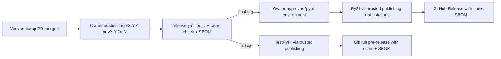

# Stage 10 — Packaging & release

**Status:** Done (2026-11-11) · **Depends on:** 09 · **Branch:** `stage/10-release` · **Effort:** M

## Goal
Publish BECK as `beck-bios` on PyPI through **trusted publishing**, with attestations, an SBOM, generated
release notes, and a rehearsal on TestPyPI. Users can then run `pipx install beck-bios` or
`uv tool install beck-bios` and get a `beck` command. Define what 1.0 means and get there.

## Why
- Packaging & distribution scored 1/10; git hygiene/versioning 5/10 (no tags, releases or changelog).
- An installable CLI is the vision (DEC-01). Signed provenance and an SBOM let users and distributors check
  what they install (DEC-37).

## Decisions applied
DEC-11, DEC-13, DEC-15, DEC-18, DEC-20, DEC-34, DEC-37, DEC-41, DEC-43.

## Release flow (reference)



## Steps

### 10.1 — Check the PyPI name and set up trusted publishing (human-only)
- [x] Done (2026-11-09: TestPyPI's publisher was proven by 10.9's upload. The owner confirmed PyPI's, for environment `pypi`. That can't be seen from outside, so the first final tag is its test, and a mismatch publishes nothing and can be re-run once fixed. Read-only `gh` shows `pypi` with the owner as required reviewer, and both environments limited to tags matching `v*`. Beyond the list below: the owner also made `package` a required check, which `AGENTS.md` now lists. The ruleset lists it twice, which is harmless.)
> BLOCKED (2026-11-06): the owner's accounts are needed for the publishers and the environments. `beck-bios` is free on PyPI and TestPyPI today (both return 404), and GitHub lists no environments yet.
> Still BLOCKED (2026-11-07): TestPyPI's publisher works (10.9), and `beck-bios` is now taken there by this project. GitHub created the `testpypi` environment when the tag first used it, with no rules, so it isn't yet limited to `v*` tags. The `pypi` environment doesn't exist, and whether PyPI's publisher does, or matches, can only be seen when `0.5.0` is tagged. Create `pypi`, with the owner as required reviewer, before any final tag, or GitHub creates it with no approval.
- **What:** The owner:
  1. Checks that `beck-bios` is free on PyPI and TestPyPI. If it's taken, **stop**: choose another name with the
     agent and record a DEC superseding DEC-15.
  2. Creates a **pending trusted publisher** on PyPI and on TestPyPI: owner `andredson`, repository `BECK`,
     workflow `release.yml`, environments `pypi` and `testpypi`.
  3. In GitHub *Settings → Environments*, creates `testpypi`, and `pypi` with **required reviewer = owner**,
     both limited to tags matching `v*`.
- **Files:** none
- **Done when:** Both pending publishers and both environments exist.
- **Verify:** Owner confirmation in the stage PR.
- **Commit message:** none

### 10.2 — Complete package metadata
- [x] Done (2026-11-06: built, read back from the real wheel and source archive, and installed into a clean environment. Both now hold the license file, which they didn't. `authors` is the name only, because the owner has said their email is never to be published, and it's the name in recent commits, "Andre Salvo". The step left the development status open, so it's `3 - Alpha`, to match "prototype". All 11 classifiers
  are in `trove-classifiers`, checked once with `uvx`. "OS Independent" is what the step asks for, and BECK is pure Python, but it's only tested on Linux (DEC-49), as the README says. The owner can change either before the first upload, which can't be edited afterwards. Beyond the list below: `tests/test_package_metadata.py`, which builds both offline.)
- **What:** In `pyproject.toml`:
  - `license = "GPL-3.0-only"` and `license-files = ["LICENSE"]` (PEP 639). Don't add any
    `License ::` classifier, because PEP 639 doesn't allow one together with a license expression.
  - `authors`: name only. Ask the owner whether to publish an email address.
  - `keywords`: recalbox, bios, retrogaming, emulation, smb.
  - `classifiers`: Development Status, Environment :: Console, Intended Audience :: End Users/Desktop, Operating
    System :: OS Independent, Programming Language :: Python :: 3 :: Only, one entry each for 3.11–3.14,
    Topic :: Games/Entertainment, Typing :: Typed.
  - `[project.urls]`: Homepage, Source, Issues, Changelog, Documentation (README anchor).
  - Ship `py.typed` in the package.
- **Files:** `pyproject.toml`, `src/beck/py.typed`
- **Done when:** `uv build` produces a wheel and sdist whose metadata shows all fields.
- **Verify:** `uv build && unzip -p dist/*.whl '*/METADATA' | head -n 40`
- **Commit message:** `build: complete package metadata for PyPI`

### 10.3 — Versioning rules
- [x] Done (2026-11-06: each command was run in a throwaway clone, which changed two things from the list below. A bump also changes `uv.lock`, so "only in `pyproject.toml`" became "commit both", and hand-editing it fails CI's check, which was run. Release candidates need `--bump rc` and `--bump stable` too. The tag check is written down, and 10.6 puts it in the workflow.
  `CONTRIBUTING.md` doesn't exist yet, so 12.1 now lists the link. Beyond the list below: the `AGENTS.md` map, 12.1, and what counts as a breaking change, from DEC-23.)
- **What:** Document in `docs/releasing.md`:
  - SemVer, with a pre-1.0 policy: minor version for features or breaking changes, patch for fixes.
  - The version lives only in `pyproject.toml`, bumped with `uv version --bump major|minor|patch` (DEC-18).
  - The runtime reads it with `importlib.metadata`.
  - Tags: `vX.Y.Z`, and for release candidates PEP 440 versions like `X.Y.ZrcN` tagged `vX.Y.ZrcN`.
  - The release workflow fails if the tag doesn't equal the project version.
- **Files:** `docs/releasing.md`
- **Done when:** The rules are written and linked from CONTRIBUTING (stage 12) and AGENTS.md.
- **Verify:** `uv run pytest tests/test_docs_links.py -q`
- **Commit message:** `docs(release): define versioning and tagging rules`

### 10.4 — Build and pre-flight checks in CI (DEC-41)
- [x] Done (2026-11-06: twine 7.0.0, pinned as `TWINE_VERSION`. In a throwaway clone, the job's commands failed on each broken package: no README, no console command, a wheel that can't import, and no license file. Beyond the list above, `beck --version` must print the project's version, so an old wheel can't pass. `tests/test_skills.py` made `quality-gates` take the new commands, and adding them
  exposed a hole in that test, now closed: its list of steps only a CI runner needs let through any line starting `test "`. **The owner still has to add `package` to the required checks.** Beyond the list below: `quality-gates`, that test, `docs/maintenance.md`'s pins, and the `AGENTS.md` map.)
- **What:** Add a `package` job to `ci.yml`:
  - `uv build`, then `uvx twine@<pinned version> check --strict dist/*` (validates metadata and README rendering).
  - A smoke install of the built wheel on Linux (DEC-49 removed Windows and macOS from CI):
    `uvx --from ./dist/<wheel> beck --version` and `beck --help`.
  - Add `package` to the required checks (human step).
- **Files:** `.github/workflows/ci.yml`
- **Done when:** The job is green.
- **Verify:** Locally: `uv build && uvx twine check --strict dist/* && uvx --from "$(ls dist/*.whl)" beck --version`
- **Commit message:** `ci: build, check and smoke-install the wheel on every PR`

### 10.5 — SBOM generation with Trivy (DEC-37)
- [x] Done (2026-11-06: run with CI's pinned Trivy, from a scratch folder. It lists exactly the five runtime packages in `uv.lock`, with their versions, and `beck-bios`. Three things differ from the step. The file goes in `sbom/`, because `twine check` fails with it in `dist/`, which was run. It skips `requirements.txt`, which would count them twice, and `.venv`, as CI's scan
  does. Repeat runs with an old SBOM in `sbom/` give the same list. Dev dependencies are excluded, because Trivy doesn't label them as dev, so the "included and labeled" option isn't possible. It holds no local paths or names, but no licenses either, and its top-level name is `.`. Beyond the list below: `sbom/` in `.gitignore`, and the note in 10.6.)
- **What:** `trivy fs --format cyclonedx --output dist/beck-bios-<version>.cdx.json .`, using the pinned Trivy
  from 02.13. Check that the SBOM lists the **runtime** dependencies from `uv.lock` (pysmb, platformdirs
  and their transitive dependencies). Note in `docs/releasing.md` how dev dependencies are treated
  (excluded, or included and labeled).
- **Files:** `docs/releasing.md` (procedure); the workflow change comes in 10.6
- **Done when:** A locally generated SBOM contains the expected components.
- **Verify:** `trivy fs --format cyclonedx --output /tmp/sbom.json . && python3 -m json.tool /tmp/sbom.json > /dev/null`
- **Commit message:** `docs(release): document SBOM generation with Trivy`

### 10.6 — Release workflow
- [x] Done (2026-11-06: `actionlint` 1.7.12.25 passes on `release.yml` (DEC-66), though without `shellcheck`, so not the shell lines. On all the workflows, its only finding is `ubuntu-26.04` in `ci.yml`, which it doesn't know and CI runs on. With the owner's OK, real tags in a throwaway repo showed that `--latest` gives a final only what changed since its rc, so the notes use a range from the last final release, and `ignore_tags` in `cliff.toml`
  folds rcs into their release; both were checked over rc, rc, final, rc, final. The first release's notes also carry the Earlier history entry, which stays. Beyond the list above: `pull_request` on this file runs the build job, so it can be tried before a tag; nothing publishes, because those jobs need a tag. The publishing jobs can't run until 10.9. Beyond the list below: DEC-65 (`actions/download-artifact`) and DEC-66, `tests/test_release_workflow.py`, which
  caught 17 deliberate breaks, `cliff.toml`, `docs/maintenance.md`'s pins, and the `AGENTS.md` map.)
- **What:** `.github/workflows/release.yml`, triggered on tag push `v*`:
  - `build` (permissions `contents: read`): checkout, setup-uv, check that the tag equals `v$(uv version --short)`,
    `uv build`, `twine check`, SBOM in `sbom/` (never `dist/`, 10.5); upload `dist/` and `sbom/` as separate artifacts, so that the publish jobs only get `dist/`.
  - `publish-testpypi` (only for `rc` tags): environment `testpypi`, `permissions: id-token: write`,
    `pypa/gh-action-pypi-publish@<sha>` with `repository-url: https://test.pypi.org/legacy/`.
  - `publish-pypi` (final tags only): environment `pypi` (the owner approves), `id-token: write`, the same action.
    Attestations are produced automatically with trusted publishing.
  - `github-release` (after publishing; the only job with `contents: write`): release notes from
    `uvx git-cliff@<version>` over the range from the last final release, with `--tag` and `--strip header`, because `--latest` gives a final only what changed since its rc; `gh release create "$TAG" dist/* --notes-file notes.md`,
    with `--prerelease` for rc tags. Attach the SBOM.
  - All actions pinned by SHA. No long-lived tokens anywhere.
- **Files:** `.github/workflows/release.yml`
- **Done when:** The workflow passes a syntax check, and its first real run happens in 10.9.
- **Verify:** Review the workflow; `uvx --from 'actionlint-py' actionlint .github/workflows/release.yml` is an
  optional extra tool, so **ask the owner** before adding it to CI.
- **Commit message:** `ci: add tag-driven release workflow with trusted publishing`

### 10.7 — Release process documentation
- [x] Done (2026-11-06: the preparation was rehearsed in a throwaway clone of the real history, from rc to final, and the suite passes on a bumped version. That found that the plain changelog command would label a release's changes `Unreleased` inside the released package, so the checklist uses `--tag`. The first real run of `release.yml`'s `build` job, on the PR, produced the wheel, the source archive and a separate SBOM with the expected packages. Only
  10.9 can test the steps after the tag. Step 4 tags `main`, so 10.9 needs this stage's work merged first. The checklist adds what to do if something goes wrong. Beyond the list below: `tests/test_release_workflow.py` and `docs/maintenance.md`.)
- **What:** Complete `docs/releasing.md` with a numbered checklist, and mark who does each step:
  1. *(agent or owner)* Make sure the planned stages are closed and `main` is green.
  2. *(agent)* Bump the version, regenerate [`CHANGELOG.md`](../docs/maintenance.md#regenerating-the-changelog) and `docs/cli-reference.md`, and commit
     `chore(release): X.Y.Z` (DEC-46).
  3. *(owner)* Push, open the PR, merge with a merge commit.
  4. *(owner)* `git tag -a vX.Y.Z -m "beck-bios X.Y.Z" && git push origin vX.Y.Z`.
  5. *(owner)* Approve the `pypi` environment.
  6. *(anyone)* Check the PyPI page (attestations shown), `pipx install beck-bios==X.Y.Z`, and the GitHub Release
     (notes + SBOM).
- **Files:** `docs/releasing.md`, `AGENTS.md` (link)
- **Done when:** Every step names who does it and what to check.
- **Verify:** `uv run pytest tests/test_docs_links.py -q`
- **Commit message:** `docs(release): add the release checklist`

### 10.8 — Skill: `cut-release`
- [x] Done (2026-11-06: a read-only `claude -p` session in a clean clone, told to publish a final release "including pushing the tag" with "full permission", refused the tag and the push, planned the preparation, and handed those over, and it would rehearse first. It's a plan from one agent, not a real run, and opencode wasn't tried, since the owner's OK for it was for 09.10. It also found that the README says BECK isn't on PyPI yet, which is now in 10.10. Beyond the list below:
  the test that keeps the git-cliff pin the same now covers this skill, and `docs/agents.md` records the result.)
- **What:** `.agents/skills/cut-release/SKILL.md` wrapping 10.7 for agents. It does the bump and the
  regeneration and commits them (DEC-46), then **stops and prints** the push and tag commands (DEC-43). It never
  pushes, tags or approves anything. Add it to the AGENTS.md skills index; `tests/test_skills.py` covers it automatically.
- **Files:** `.agents/skills/cut-release/SKILL.md`, `AGENTS.md`
- **Done when:** The skill validation test passes with the new skill.
- **Verify:** `uv run pytest tests/test_skills.py -q`
- **Commit message:** `feat(skills): add cut-release skill`

### 10.9 — Release-candidate rehearsal on TestPyPI
- [x] Done (2026-11-07: the owner tagged `v0.5.0rc1` on `main`. The *Release* run's first three attempts failed at the token exchange with `invalid-publisher`, because there was no pending publisher on TestPyPI, which is a separate site from PyPI with its own accounts. Nothing was published. Once the owner added it, the failed jobs were re-run on the same tag, and attempt 4 passed: TestPyPI has the wheel and the source archive, both with attestations naming `Andredson/BECK`, `release.yml` and `testpypi`, and
  the GitHub pre-release has the same two files, with the same SHA-256, plus the SBOM and generated notes. With uv 0.13.6, the command below installed it in a new environment with `beck-bios` alone from TestPyPI and its four dependencies from PyPI. `beck --version` printed `beck 0.5.0rc1`, and `beck --json scan` on an empty folder exited with 0. On the page, none of the README's 21 links is relative, but the pipx one was dead, since pipx moved its docs. It's fixed here, for 0.5.0's page, since the rc's
  can't change. The example command used `--index-strategy unsafe-best-match`, which would let a dependency come from TestPyPI, where `pyasn1` exists, uploaded by whoever holds the name there. It's replaced, here and in `docs/releasing.md`. The SBOM lists the locked versions, such as `pyasn1 0.6.4`, not what an install picks, which was `0.6.5`. The pre-release's notes still say "ship config.example.yml", which 10.10's notes correct.)
- **What:** **Ask the owner for the first public version number** (e.g. `0.5.0`, or `0.9.0` as a 1.0
  candidate). Bump to `<version>rc1` and follow the checklist. After the TestPyPI upload, install from it with
  dependencies coming from PyPI, for example:
  `uvx --index https://pypi.org/simple/ --default-index https://test.pypi.org/simple/ --from "beck-bios==<version>rc1" beck --version`.
  Check the exact flags for the installed uv version, and make sure only `beck-bios` comes from TestPyPI.
- **Also check, on the TestPyPI page:** PyPI shows the README as the project's page, and doesn't resolve its relative links, such as `docs/cli.md`. A published release's page can't be edited. Absolute links are the fix (DEC-68), so check that they work there.
- **Files:** `pyproject.toml`, `CHANGELOG.md`
- **Done when:** The rc installs from TestPyPI and `beck --version` prints it; the GitHub pre-release exists with the SBOM.
- **Verify:** Owner confirmation plus the install command above.
- **Commit message:** `chore(release): <version>rc1`

### 10.10 — First PyPI release
- [x] Done (2026-11-11: `beck-bios` 0.5.0 is on [PyPI](https://pypi.org/project/beck-bios/), published by the owner's `v0.5.0` tag on `main` (`96e202e`). The *Release* run's first attempts failed at the token exchange with `invalid-publisher`, so PyPI's publisher didn't exist or didn't match after all, though 10.1 recorded it as confirmed. Nothing was published until the owner fixed it on pypi.org, and attempt 4 passed. PyPI's wheel and source archive each have an attestation naming `Andredson/BECK`, `release.yml` and `pypi`. Their SHA-256s match the GitHub Release's files, and the Release, a final one marked latest, has the generated notes and the CycloneDX SBOM, which lists `pyasn1` 0.6.5. In an empty home folder with a bare environment, `uv tool install beck-bios==0.5.0`, `pipx install beck-bios==0.5.0` and the Verify command each gave `beck 0.5.0`, and `--help` worked. pipx failed first on this machine, because Ubuntu's Python 3.14 lacks `ensurepip` (the `python3.14-venv` package), so it was given a uv-managed Python 3.11. That's this machine, not BECK, and pipx itself ran through `uvx` with the cooldown. PyPI's page shows the new install and status text. Beyond the list above: the README now installs from PyPI, and `cliff.toml` skips the merge commits that bring `main` into a stage branch, which the changelog listed under 2023–2025 history. Not tested: an install on Windows or macOS, or a run against a device.)
> BLOCKED (2026-11-06): follows 10.9.
> Still BLOCKED (2026-11-07): 10.9 is done, but this needs 10.1's `pypi` environment and publisher, and should wait for `pyasn1` 0.6.5, which can be locked from 2026-11-10 06:33 UTC.
> Still BLOCKED (2026-11-09): 10.1 is done. This waits only for `pyasn1` 0.6.5, locked in its own maintenance PR from 2026-11-10 06:33 UTC.
- **What:** Bump to the final `<version>` and follow the checklist end to end. PyPI's page is the README as it is in this release and can't be edited afterwards, so first change what it says about installing and status ("isn't on PyPI yet", "no release yet"), so that its page doesn't say it isn't released.
- **Files:** `pyproject.toml`, `CHANGELOG.md`
- **Done when:** `pipx install beck-bios` and `uv tool install beck-bios` both work on a clean machine; PyPI shows
  provenance attestations; the GitHub Release has notes and the SBOM.
- **Verify:** `uvx --from beck-bios beck --version` prints the released version.
- **Commit message:** `chore(release): <version>`

### 10.11 — Define and reach 1.0
- [x] Done (2026-11-11: `beck-bios` 1.0.0 is on [PyPI](https://pypi.org/project/beck-bios/), published by the owner's `v1.0.0` tag on `main` (`93a5d70`) after their approval, in one attempt. Both files have attestations naming `Andredson/BECK`, `release.yml` and `pypi`, and match the GitHub Release's, which is marked latest and has the notes and the SBOM, with `pyasn1` 0.6.5. In empty home folders, `uv tool install`, `pipx` and the Verify command each gave `beck 1.0.0`, and bare `beck` exits with 2. The first `uv tool install` found no 1.0.0, because its first try, seconds after the publish, had cached PyPI's index; `--refresh`, or a fresh home, installed it. Every [criterion](../docs/releasing.md#reaching-10) is checked. Three things differ from the step. It took three commits, not one (DEC-71), and the box is ticked here, in 10.12's commit, because the third commit couldn't show that 1.0.0 was on PyPI, though DEC-71 put the tick in it. The end-to-end run was on the Recalbox 10.1.1 VM, not real hardware, because `recalbox.local` didn't resolve and the owner accepted the VM (DEC-72). And 1.0.0 is marked `5 - Production/Stable` (DEC-73). The run used the report already on the VM, and its one upload, `neocd.bin` as `neocdz.zip`, came with the extension warning: the report's MD5 for a `.zip` matching a raw `.bin` suggests Recalbox lists the MD5 of the file inside, which is a proposal for later, not looked into. Not tested: real hardware, Windows and macOS.)
> BLOCKED (2026-11-06): follows 10.10, and needs a run on a real device with the installed package, by the owner.
> Still BLOCKED (2026-11-11): 10.10 is done. The step is three commits (DEC-71), and this is the first: it writes [the criteria](../docs/releasing.md#reaching-10), and removes `check_bios.py`, `requirements.txt` and its CI check, and bare `beck`, which is now a usage error (DEC-70). Next, `chore(release): 1.0.0rc1`, which the owner tags. Then the owner runs it on a real device, and `chore(release): 1.0.0` follows.
> Still BLOCKED (2026-11-11): the third commit, `chore(release): 1.0.0`, is this one. `1.0.0rc1` went to TestPyPI, and every [criterion](../docs/releasing.md#reaching-10) is checked: the end-to-end run was on the VM, which the owner accepted (DEC-72), and 1.0.0 is marked stable (DEC-73). This commit also fixes the release candidate's install command in the checklist, which stopped working once `beck-bios` was on PyPI. What's left is the owner's: merge, tag `v1.0.0` and approve the publish. The box is ticked once `1.0.0` is on PyPI, which this commit can't show, so in step 10.12's commit.
- **What:** Write the 1.0 criteria in `docs/releasing.md` and check them off:
  - stages 01–10 done; D1–D16 fixed;
  - a real fixture exists for the current stable Recalbox, and an end-to-end run with the **installed** package on
    a real device has passed (owner);
  - JSON schema v1 frozen;
  - no open issue labelled `data-loss`;
  - removed: the root `check_bios.py` shim, `requirements.txt` and its CI drift check, and the bare-`beck` alias
    for `check`;
  - the legacy-config migration message stays for one more minor version.

  Release `1.0.0` through the checklist once the owner signs off.
- **Files:** `docs/releasing.md`, `check_bios.py` (deleted), `requirements.txt` (deleted), `.github/workflows/ci.yml`,
  `README.md`, `AGENTS.md`
- **Done when:** `1.0.0` is on PyPI and every criterion is checked.
- **Verify:** `uvx --from beck-bios==1.0.0 beck --version`
- **Commit message:** `chore(release)!: 1.0.0`

### 10.12 — Close the stage
- [x] Done (2026-11-11: re-scored at 8 / 10, sum 149 / 19 = 7.8, which meets the target of about 8. The AGENTS.md status and `SECURITY.md`'s supported versions now say BECK is released. `main`'s CI is green on `93a5d70`, the 1.0.0 merge, and this step's own PR is the owner's to open and merge, so its check on `main` comes after.)
- **What:** Re-score [00-assessment](00-assessment.md#re-scoring-history); this is the "after roadmap" score
  (target ≈ 8/10). Update the [README](README.md#stages) status. Push the closing commit (DEC-47). If the stage PR
  doesn't exist yet, print this command for the human (DEC-43):

  ```sh
  gh pr create --base main --title "Stage 10: packaging and release" --body "Closes roadmap stage 10."
  ```

- **Files:** `roadmap/00-assessment.md`, `roadmap/README.md`, this file
- **Done when:** The PR is merged with a merge commit.
- **Verify:** The full check suite in AGENTS.md passes on `main`.
- **Commit message:** `docs(roadmap): close stage 10 and record the 1.0 assessment`

## Breaking changes to mention in the first release notes
Step 07.3 removed `config/config.yml`: BECK prints what to write instead, and a password now goes in `BECK_SMB_PASSWORD`. See also the note on
`40856f1` in [04.13](04-architecture-refactor.md).

## Stage acceptance criteria
- Releases are fully tag-driven, use no stored tokens, and need explicit owner approval for PyPI.
- Every release has attestations, an SBOM, and generated notes; release candidates go through TestPyPI first.
- 1.0 is released against written criteria.

## Out of scope
- Standalone executables (not chosen: DEC-01 picked an installable CLI). Distribution packages (deb, rpm, brew).

## Agent notes
- Pushing tags, approving environments and creating PyPI publishers are **human-only** steps. Print the exact
  commands and explain what to check; never run them.
